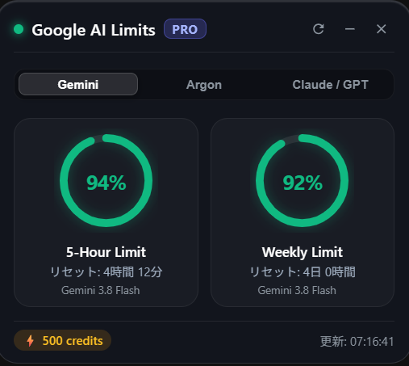
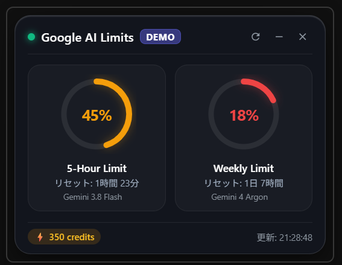

# Google AI Limit Monitor (Windows Desktop Gadget)

Google AI（Antigravity / Gemini）の利用枠である **「5-Hour Rolling Limit（5時間枠）」** および **「Weekly Limit（週間上限枠）」** の最新クォータ消費状況をデスクトップ上にリアルタイム表示する、Windows専用の常駐型デスクトップガジェットです。

<div align="center">
  <table>
    <tr>
      <td align="center">
        <b>🟢 通常・安全時 (80%〜)</b><br />
        
      </td>
      <td align="center">
        <b>🟡 注意 (30〜79%) / 🔴 警告 (〜29%)</b><br />
        
      </td>
    </tr>
  </table>
</div>

---

## ✨ 主な特徴

- 🪟 **デスクトップ常駐 & 常に最前面 (Always On Top)**: 開発作業中も画面の隅に常に配置され、クォータ残量をいつでも一目で確認できます。
- 🎨 **洗練されたフロストガラス & デュアルメーターUI**:
  - **5-Hour Limit（短期枠）**: Gemini Flash などのローリングリセット残量と次回リセットまでのカウントダウン
  - **Weekly Limit（週間枠）**: Gemini Argon などの週間リセット残量と次回リセットまでのカウントダウン
  - **3段階のカラーゲージ変化**:
    - 🟢 **80% 〜 100% (安全)**: エメラルドグリーン
    - 🟡 **30% 〜 79% (注意)**: アンバーオレンジ
    - 🔴 **0% 〜 29% (警告)**: ネオンレッド（枠枯渇寸前）
- ⚡ **超軽量設計 (Tauri 2.0 + Rust)**:
  - Windows標準の Edge WebView2 を利用するため、常駐時のメモリ消費量はわずか数十MB。
  - 完成した `.exe` は単一ポータブル実行ファイルとして動作（Node.js や Python などのランタイム不要）。
- 🔄 **完全自動検出 & ローカルRPC通信**:
  - ローカルで稼働している Language Server プロセスからポートと認証トークンを自動抽出し、直接 Connect-RPC（`127.0.0.1`）経由で最新データを10分ごとに自動取得（手動即時更新も可能）。
- 🖱️ **スムーズなタイトルバードラッグ**: ウィンドウ上部のタイトルバー領域を掴んで画面上の任意の位置へ手軽に配置可能。
- 🧪 **デモ（エミュレーション）モード**:
  - タイトルバーのプランバッジ（`[PRO]`）をクリックすると、いつでも警告色（45% / 18%）表示をトグルで確認できます。

---

## 🛠️ システム要件

- **OS**: Windows 10 / 11 (64-bit)
- **ランタイム**: Microsoft Edge WebView2（Windows 10/11 に標準搭載）
- **対象環境**: Google Antigravity / Gemini 開発者環境（Language Server がローカルで稼働していること）

---

## 🚀 使い方

### 1. 実行ファイルの起動
`src-tauri/target/release/google-ai-limit-monitor.exe` をダブルクリックして起動します。

### 2. ガジェットの操作
- **移動**: ウィンドウ上部のタイトルバー（`Google AI Limits` 付近）をドラッグして画面上の自由な位置へ移動できます。
- **更新 [↻]**: ボタンをクリックすると即座に最新のクォータ情報を再取得します。
- **最小化 [_]**: タスクバーへ最小化します。
- **終了 [✕]**: ガジェットを終了します。
- **デモ切り替え [PRO]**: バッジをクリックすると警告表示（オレンジ／赤）のエミュレーション表示を切り替えられます。

---

## 💻 開発・ビルド方法

### 開発環境の前提条件
- **Node.js**: v20以上
- **Rust**: 1.80以上 (MSVC ツールチェーン)
- **Visual Studio C++ Build Tools**

### 開発サーバー起動（ホットリロード）
```powershell
# 依存関係のインストール
npm install

# 開発モードで起動
npm run dev
# または
cargo run --manifest-path src-tauri/Cargo.toml
```

### リリースバイナリのビルド
```powershell
npm run build
# または
cargo build --release --manifest-path src-tauri/Cargo.toml
```
ビルド完了後、`src-tauri/target/release/google-ai-limit-monitor.exe` に単一実行ファイルが生成されます。

---

## 📜 ライセンス
MIT License
