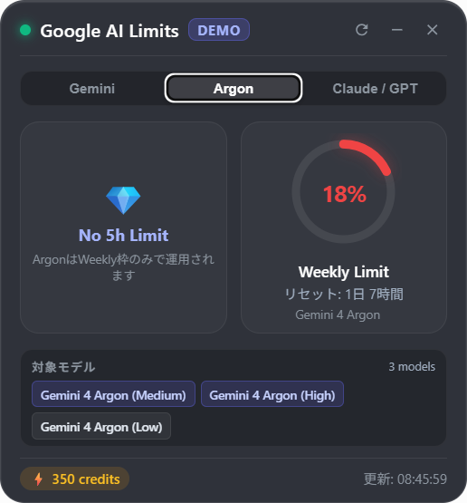
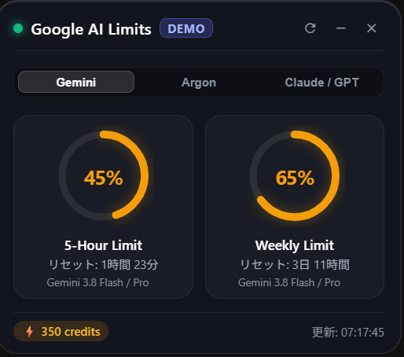

# Google AI Limit Monitor (Windows Desktop Gadget)

[](https://github.com/mowthow-works/google-ai-limit-monitor/releases)
[](https://www.microsoft.com/windows)
[](LICENSE)

Google AI（Antigravity / Gemini）の利用枠である **「5-Hour Rolling Limit（5時間枠）」** および **「Weekly Limit（週間上限枠）」** の最新クォータ消費状況をデスクトップ上にリアルタイム表示する、Windows専用の常駐型デスクトップガジェットです。

<div align="center">
  <table>
    <tr>
      <td align="center">
        <b>⚡ Gemini Models</b><br />
        
      </td>
      <td align="center">
        <b>💎 Gemini 4 Argon</b><br />
        
      </td>
    </tr>
    <tr>
      <td align="center">
        <b>🤖 Claude & GPT models</b><br />
        
      </td>
      <td align="center">
        <b>🟡 注意・警告時 (DEMOモード)</b><br />
        
      </td>
    </tr>
  </table>
</div>

---

## ✨ 主な特徴

- 🪟 **デスクトップ常駐 & 常に最前面 (Always On Top)**: 開発作業中も画面の隅に常に配置され、クォータ残量をいつでも一目で確認できます。
- 📑 **モデルグループ別のタブ切り替え対応**:
  - Antigravity の実際のクォータ管理体系に完全対応し、3つのグループをワンクリックで切り替えて正確にモニタリング可能：
    1. **Gemini**: 標準Gemini枠（5-Hour Limit & Weekly Limit）
    2. **Argon**: 最先端思考モデル専用枠（Weekly Limit ※5h制限なし）
    3. **Claude / GPT**: サードパーティモデル枠（5-Hour Limit & Weekly Limit）
- 🏷️ **最新モデル一覧の動的バッジ表示**:
  - Language Server の `GetUserStatus` から最新の利用可能モデル（Gemini 4 Argon 各バリアント、Claude Sonnet/Opus 5.5、GPT-OSS 等）を動的に取得。
  - 選択中のグループに属するモデルをタグ/バッジとして画面下部に一覧表示し、マウスホバーでモデルIDやクォータ残量（%）を確認可能。将来モデルが追加・更新された場合も自動で追従します。
- 📌 **タスクトレイ常駐 & クイックトグル**:
  - ウィンドウ右上の「✕」ボタンを押すとアプリを終了せずタスクトレイに最小化格納。
  - タスクトレイアイコンを左クリックするだけで、ガジェットの表示／非表示を素早く切り替えられます。
- 🚀 **Windowsスタートアップ自動起動（設定永続化・自動復元対応）**:
  - トレイアイコンの右クリックメニューから「Windows起動時に自動起動」の有効／無効をいつでもワンクリックで設定可能。
  - 設定内容は `%APPDATA%\com.google.ai.limit.monitor\config.json` に永続化されており、バージョンアップ（上書きインストール）等でWindowsスタートアップレジストリが消去されても、次回起動時に自動で再登録（復元）されます。
- 📥 **NSISインストーラ対応**:
  - 日本語・英語に対応したインストーラ（Setup.exe）および単一ポータブル実行ファイルに対応。
- 🎨 **洗練されたフロストガラス & デュアルメーターUI**:
  - **3段階のカラーゲージ変化**:
    - 🟢 **80% 〜 100% (安全)**: エメラルドグリーン
    - 🟡 **30% 〜 79% (注意)**: アンバーオレンジ
    - 🔴 **0% 〜 29% (警告)**: ネオンレッド（枠枯渇寸前）
- ⚡ **超軽量設計 (Tauri 2.0 + Rust)**:
  - Windows標準の Edge WebView2 を利用するため、常駐時のメモリ消費量はわずか数十MB。
  - 完成した `.exe` は単一ポータブル実行ファイルとして動作（Node.js や Python などのランタイム不要）。
- 🔄 **完全自動検出 & ローカルRPC通信**:
  - ローカルで稼働している Language Server プロセスからポートと認証トークンを自動抽出し、専用RPC（`RetrieveUserQuotaSummary`）経由で最新データを10分ごとに自動取得（手動即時更新も可能）。
- 🖱️ **スムーズなタイトルバードラッグ**: ウィンドウ上部のタイトルバー領域を掴んで画面上の任意の位置へ手軽に配置可能。
- 🔒 **単一インスタンス制御 (Single Instance)**:
  - exeを誤って複数回実行してもガジェットが重複起動しません。既存のガジェットウィンドウが自動的に最小化解除され、最前面にフォーカスされます。
- 🧪 **デモ（エミュレーション）モード**:
  - タイトルバーのプランバッジ（`[PRO]`）をクリックすると、いつでも警告色（45% / 65%）表示をトグルで確認できます。

---

## 🛠️ システム要件

- **OS**: Windows 10 / 11 (64-bit)
- **ランタイム**: Microsoft Edge WebView2（Windows 10/11 に標準搭載）
- **対象環境**: Google Antigravity / Gemini 開発者環境（Language Server がローカルで稼働していること）

---

## 📥 インストール

[Releases](https://github.com/mowthow-works/google-ai-limit-monitor/releases) からインストーラ（`Google-AI-Limit-Monitor_x64-setup.exe`）またはポータブル版 ZIP（`google-ai-limit-monitor-windows-x64.zip`）をダウンロードして実行してください。インストーラは管理者権限不要（Per-user インストール）で、デスクトップショートカット・スタートメニュー登録とアンインストーラが自動構成されます。

### Windows SmartScreen 警告が出た場合

ダウンロードしたインストーラやポータブル版の実行時に **「Windows によって PC が保護されました」** という青い画面が表示される場合があります。これは、個人開発・オープンソースの新しいバイナリに対して SmartScreen が「ダウンロード実績がまだ少ない未知のアプリ」として機械的に表示する安全確認の画面です。以下の手順でそのままインストール・起動できます。

<div align="center">
  
</div>

1. 警告画面の左上にある **「詳細情報」**（下線リンク）をクリックします。
2. 画面右下に現れる **「実行」** ボタンをクリックします。
3. 通常通りセットアップ画面（またはアプリ）が起動します。

> [!TIP]
> ダウンロードした `.exe` ファイルを右クリック ➜ **「プロパティ」** を開き、全般タブの一番下にある **「セキュリティ: 許可する」**（または「ブロックの解除」）にチェックを入れて「OK」を押すことでも警告を回避できます。

---

## 🚀 使い方

### 1. 起動と初回セットアップ
- **インストーラ版（推奨）**: `Google-AI-Limit-Monitor_x64-setup.exe` を実行してインストール後、デスクトップショートカットまたはスタートメニューから起動します。
- **ポータブル版**: `google-ai-limit-monitor-windows-x64.zip` を任意のフォルダに展開し、中の `google-ai-limit-monitor.exe` をダブルクリックするだけで、インストール不要のポータブルガジェットとして即座に起動します。
- （ローカルでソースからビルドした場合は、`src-tauri/target/release/google-ai-limit-monitor.exe` を直接起動できます）

### 2. ガジェットの操作
- **タブ切り替え [Gemini / Argon / Claude & GPT]**: クリックで各モデルグループのクォータ表示を瞬時に切り替えます。
- **移動**: ウィンドウ上部のタイトルバー（`Google AI Limits` 付近）をドラッグして画面上の自由な位置へ移動できます。
- **更新 [↻]**: ボタンをクリックすると即座に最新のクォータ情報を再取得します。
- **最小化 [_]**: タスクバーへ最小化します。
- **トレイに格納 [✕]**: ウィンドウを閉じ、タスクトレイに格納します（バックグラウンド監視を継続）。
- **デモ切り替え [PRO]**: バッジをクリックすると警告表示（オレンジ／赤）のエミュレーション表示を切り替えられます。

### 3. タスクトレイメニュー
- **左クリック**: ガジェットウィンドウの表示／非表示をトグルします。
- **右クリックメニュー**:
  - **表示 / 非表示**: ウィンドウの可視状態を切り替えます。
  - **今すぐ更新**: クォータ情報を手動で即時再取得します。
  - **Windows起動時に自動起動**: チェックを入れるとWindowsスタートアップに登録され、PC起動時に自動で立ち上がります（設定は `AppData\Roaming\com.google.ai.limit.monitor\config.json` に保存され、アップデート時も自動復元されます）。
  - **終了**: アプリケーションを完全に終了します。

---

## 💻 開発・ビルド方法

### 開発環境の前提条件
- **Node.js**: v20以上
- **Rust**: 1.80以上 (MSVC ツールチェーン)
- **Visual Studio C++ Build Tools**

### 開発サーバー起動（ホットリロード）
```powershell
# 依存関係のインストール
npm install

# 開発モードで起動
npm run dev
# または
cargo run --manifest-path src-tauri/Cargo.toml
```

### 自動テストの実行
```powershell
# Rustバックエンド単体テスト
npm run test:rust
```

### プロダクションビルド

ポータブル単体実行ファイル（手動配置・ZIP 配布向け）：
```powershell
cargo build --release --manifest-path "src-tauri/Cargo.toml"
# 生成先: src-tauri/target/release/google-ai-limit-monitor.exe
```

NSIS セットアップインストーラ（一般配布向け）：
```powershell
npm run build:installer
# または
npx tauri build
# 生成先: src-tauri/target/release/bundle/nsis/Google AI Limit Monitor_<version>_x64-setup.exe
```

---

## 📜 ライセンス

[MIT License](LICENSE) © 2026 mowthow-works
