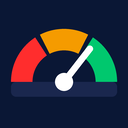
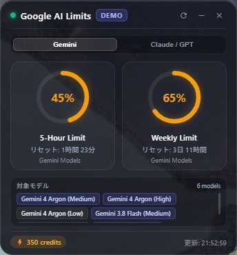
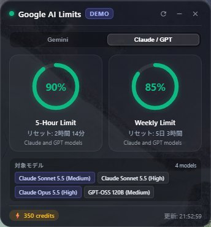
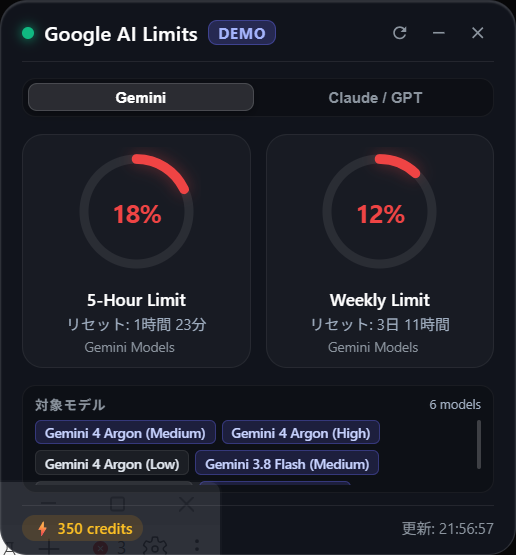
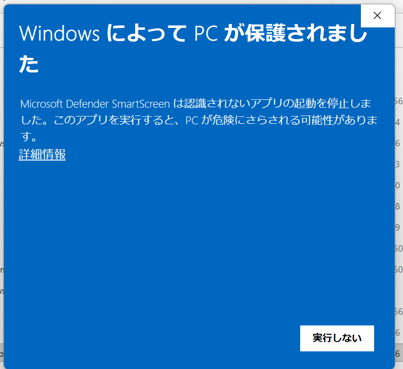

#  Google AI Limit Monitor (Windows Desktop Gadget)

[](https://github.com/mowthow-works/google-ai-limit-monitor/releases)
[](https://www.microsoft.com/windows)
[](LICENSE)

Google AI（Antigravity / Gemini）の利用枠である **「5-Hour Rolling Limit（5時間枠）」** および **「Weekly Limit（週間上限枠）」** の最新クォータ消費状況をデスクトップ上にリアルタイム表示する、Windows専用の常駐型デスクトップガジェットです。

<div align="center">
  
</div>

---

## 📸 スクリーンショット

残量に応じてゲージカラーが **安全（緑）→ 注意（黄）→ 警告（赤）** の3段階で変化し、モデルグループごとにタブで切り替えて確認できます。

<div align="center">
  <table>
    <tr>
      <td align="center" width="33%">
        <b>🟢 安全 (80%〜100%)</b><br />
        <sub>Claude / GPT タブ</sub><br />
        
      </td>
      <td align="center" width="33%">
        <b>🟡 注意 (30%〜79%)</b><br />
        <sub>Gemini タブ</sub><br />
        
      </td>
      <td align="center" width="33%">
        <b>🔴 警告 (0%〜29%)</b><br />
        <sub>Gemini タブ（警告表示）</sub><br />
        
      </td>
    </tr>
  </table>
</div>

---

## ✨ 主な特徴

### 表示・UI
- 🪟 **デスクトップ常駐 & 常に最前面 (Always On Top)**: 開発作業中も画面の隅に常に配置され、クォータ残量をいつでも一目で確認できます。
- 📑 **クォータ保持グループに応じた動的タブ切り替え対応**: Antigravity（Language Server / `agy` CLI）から返却されるクォータ保持グループの構造に合わせて、タブを動的に構成してワンクリックで切り替えられます。
  - 現行の 2 グループ構成では **Gemini**（Argon を含む Gemini 共通枠：5-Hour Limit & Weekly Limit）と **Claude / GPT**（5-Hour Limit & Weekly Limit）を表示します。
  - 将来や旧環境で独立したクォータ枠（Weekly 専用枠や新規グループ等）が存在する場合は、自動的に該当タブが追加表示されます。
- 🏷️ **最新モデル一覧の動的バッジ表示**: Language Server の `GetUserStatus` から最新の利用可能モデルを動的に取得し、選択中のグループに属するモデルを画面下部へ一覧表示します（ホバーでモデル ID や残量 % を確認可能）。
- 🎨 **洗練されたフロストガラス & 3段階カラーゲージ**: 残量に応じて **🟢 80〜100%（安全）** / **🟡 30〜79%（注意）** / **🔴 0〜29%（警告）** へ変化します。
- 🖱️ **スムーズなタイトルバードラッグ**: ウィンドウ上部のタイトルバー領域を掴んで画面上の任意の位置へ手軽に配置できます。

### 常駐まわり
- 📌 **タスクトレイ常駐 & クイックトグル**: ウィンドウ右上の「✕」でアプリを終了せずタスクトレイへ格納し、トレイアイコンの左クリックで表示／非表示を素早く切り替えられます。
- 🚀 **Windows スタートアップ自動起動（設定永続化・自動復元対応）**: トレイの右クリックメニューからワンクリックで設定でき、設定は `%APPDATA%\com.google.ai.limit.monitor\config.json` に保存されます。上書きインストール等でレジストリが消去されても、次回起動時に自動で復元されます。
- 🔒 **単一インスタンス制御 (Single Instance)**: `.exe` を重複して起動しても多重起動せず、既存ウィンドウが自動で最小化解除・最前面フォーカスされます。

### 取得の仕組み
- 🆕 **Antigravity 2.x 対応**: Antigravity 2.x（`language_server.exe`）の新仕様に対応し、`%USERPROFILE%\.gemini\antigravity\daemon\hub_*.json` から稼働中プロセスの接続情報を自動検出します。従来の `--csrf_token` コマンドライン引数による検出（Antigravity 1.x）もフォールバックとして維持しています。
- 🔄 **完全自動検出 & ローカル RPC 通信**: 検出したローカルポートと CSRF トークンを用い、ローカルホスト上の RPC（`GetUserStatus` / `RetrieveUserQuotaSummary`）から10分ごとに自動取得します（手動即時更新も可能）。
- 🛟 **agy CLI フォールバック対応**: Antigravity IDE を閉じている間も、`agy` CLI（`agy -p "/usage" --output-format json`）が利用可能な環境では自動でフォールバック取得し、IDE 再起動後は自動で RPC 取得へ復帰します。

### その他
- 📥 **NSIS インストーラ & ポータブル版対応**: 日本語・英語に対応した Setup インストーラと、展開するだけのポータブル版 ZIP の両方を提供しています。
- ⚡ **超軽量設計 (Tauri 2.0 + Rust)**: Windows 標準の Edge WebView2 を利用するためメモリ消費が少なく、Node.js や Python などのランタイムも不要です。
- 🧪 **デモ（エミュレーション）モード**: タイトルバーのプランバッジ（`[PRO]` 等）をクリックすると、注意・警告色表示をいつでもテスト確認できます。

---

## 🛠️ システム要件

- **OS**: Windows 10 / 11 (64-bit)
- **ランタイム**: Microsoft Edge WebView2（Windows 10/11 に標準搭載）
- **対象環境**: Google Antigravity 2.x（および 1.x）環境
  - 通常時：ローカルで Language Server が稼働していること
  - フォールバック時：`agy` CLI（`%LOCALAPPDATA%\agy\bin\agy.exe` または `PATH` 上の `agy.exe`）が利用可能な場合、Antigravity IDE を閉じていても 5-Hour / Weekly 残量を取得可能

---

## 📥 インストール

[Releases](https://github.com/mowthow-works/google-ai-limit-monitor/releases) からインストーラ（`Google-AI-Limit-Monitor_x64-setup.exe`）またはポータブル版 ZIP（`google-ai-limit-monitor-windows-x64.zip`）をダウンロードして実行してください。インストーラは管理者権限不要（Per-user インストール）で、デスクトップショートカット・スタートメニュー登録とアンインストーラが自動構成されます。

### Windows SmartScreen 警告が出た場合

ダウンロードしたインストーラやポータブル版の実行時に **「Windows によって PC が保護されました」** という青い画面が表示される場合があります。これは、個人開発・オープンソースの新しいバイナリに対して SmartScreen が「ダウンロード実績がまだ少ない未知のアプリ」として機械的に表示する安全確認の画面です。以下の手順でそのままインストール・起動できます。

<div align="center">
  
</div>

1. 警告画面の左上にある **「詳細情報」**（下線リンク）をクリックします。
2. 画面右下に現れる **「実行」** ボタンをクリックします。
3. 通常通りセットアップ画面（またはアプリ）が起動します。

> [!TIP]
> ダウンロードした `.exe` ファイルを右クリック ➜ **「プロパティ」** を開き、全般タブの一番下にある **「セキュリティ: 許可する」**（または「ブロックの解除」）にチェックを入れて「OK」を押すことでも警告を回避できます。

---

## 🚀 使い方

### 1. 起動と初回セットアップ
- **インストーラ版（推奨）**: `Google-AI-Limit-Monitor_x64-setup.exe` を実行してインストール後、デスクトップショートカットまたはスタートメニューから起動します。
- **ポータブル版**: `google-ai-limit-monitor-windows-x64.zip` を任意のフォルダに展開し、中の `google-ai-limit-monitor.exe` をダブルクリックするだけで、インストール不要のポータブルガジェットとして即座に起動します。
- （ローカルでソースからビルドした場合は、`src-tauri/target/release/google-ai-limit-monitor.exe` を直接起動できます）

### 2. ガジェットの操作
- **タブ切り替え（動的構成）**: クリックでクォータを持つ各モデルグループ（例: `Gemini` / `Claude / GPT` 等）の表示を瞬時に切り替えます。
- **移動**: ウィンドウ上部のタイトルバー（`Google AI Limits` 付近）をドラッグして画面上の自由な位置へ移動できます。
- **更新 [↻]**: ボタンをクリックすると即座に最新のクォータ情報を再取得します。
- **最小化 [_]**: タスクバーへ最小化します。
- **トレイに格納 [✕]**: ウィンドウを閉じ、タスクトレイに格納します（バックグラウンド監視を継続）。
- **デモ切り替え [PRO]**: バッジをクリックすると注意／警告表示のエミュレーション表示を切り替えられます。

### 3. タスクトレイメニュー
- **左クリック**: ガジェットウィンドウの表示／非表示をトグルします。
- **右クリックメニュー**:
  - **表示 / 非表示**: ウィンドウの可視状態を切り替えます。
  - **今すぐ更新**: クォータ情報を手動で即時再取得します。
  - **Windows起動時に自動起動**: チェックを入れると Windows スタートアップに登録され、PC 起動時に自動で立ち上がります（設定は `%APPDATA%\com.google.ai.limit.monitor\config.json` に保存され、アップデート時も自動復元されます）。
  - **終了**: アプリケーションを完全に終了します。

---

## ❓ FAQ

### Q1. クォータが表示されない／「Language Server 待機中...」のままになります
まず Antigravity が起動して Language Server（`language_server.exe`）が稼働しているかご確認ください。本アプリは Antigravity 2.x の `%USERPROFILE%\.gemini\antigravity\daemon\hub_*.json` から接続情報を取得し、見つからない場合は従来の `--csrf_token` コマンドライン引数による検出へフォールバックします。

Language Server が未稼働の場合でも、`agy` CLI（`%LOCALAPPDATA%\agy\bin\agy.exe` または `PATH` 上の `agy.exe`）が利用可能であれば自動的に `agy -p "/usage" --output-format json` へフォールバックしてクォータ残量を取得します（`num_turns=0` でクォータは消費しません）。
- `agy` 経由での取得中は、フッターに **`via agy`** が表示され、CLI 出力に含まれない項目（プラン名・Prompt Credits・対象モデル一覧詳細）は **`―`** 表示になります。
- Antigravity を起動して Language Server が復帰すると、次回の更新時に自動で通常の RPC 表示に戻ります。
- `agy` 未インストール環境で「Language Server 待機中...」が続く場合は、Antigravity 起動直後に数秒待つか、右上の更新ボタン `[↻]` をクリックしてください。

### Q2. データが外部に送信されることはありますか？
ありません。クォータ情報の取得はすべてローカルマシン上（`https://127.0.0.1:<port>`）で稼働する Language Server へのローカル RPC 通信のみで完結しており、外部サーバーへのデータ送信は行いません。

### Q3. 起動しても画面が出ない／2つ目を起動しようとしても増えません
単一インスタンス制御により、すでに起動中の場合は新しいプロセスは立ち上がらず、既存ウィンドウが最小化解除・最前面表示されます。トレイに格納されている場合は、タスクトレイのアイコンを左クリックして再表示してください。

### Q4. 実行時に「Windows によって PC が保護されました」と表示されます
[Windows SmartScreen 警告が出た場合](#windows-smartscreen-警告が出た場合) の手順で「詳細情報」→「実行」を選択してください。

---

## 💻 開発・ビルド方法

> 開発・リリース時の運用ルールについては [AGENTS.md](AGENTS.md) を参照してください。

### 開発環境の前提条件
- **Node.js**: v20以上
- **Rust**: 1.80以上 (MSVC ツールチェーン)
- **Visual Studio C++ Build Tools**

### 開発サーバー起動（ホットリロード）
```powershell
# 依存関係のインストール
npm install

# 開発モードで起動
npm run dev
# または
cargo run --manifest-path src-tauri/Cargo.toml
```

### 自動テストの実行
```powershell
# Rustバックエンド単体テスト
npm run test:rust
```

### プロダクションビルド

ポータブル単体実行ファイル（手動配置・ZIP 配布向け）：
```powershell
cargo build --release --manifest-path "src-tauri/Cargo.toml"
# 生成先: src-tauri/target/release/google-ai-limit-monitor.exe
```

NSIS セットアップインストーラ（一般配布向け）：
```powershell
npm run build:installer
# または
npx tauri build
# バンドル生成先: src-tauri/target/release/bundle/nsis/Google AI Limit Monitor_<version>_x64-setup.exe
# ※ 固定ダウンロードリンク運用のため、配布時は Google-AI-Limit-Monitor_x64-setup.exe にリネームして公開します
```

---

## 📜 ライセンス

[MIT License](LICENSE) © 2026 mowthow-works
